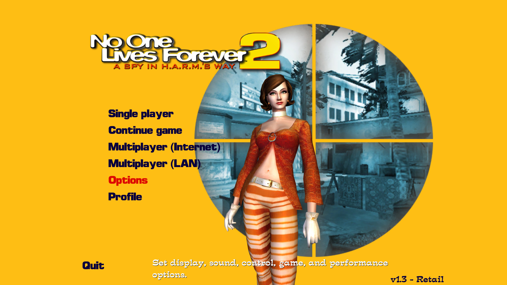
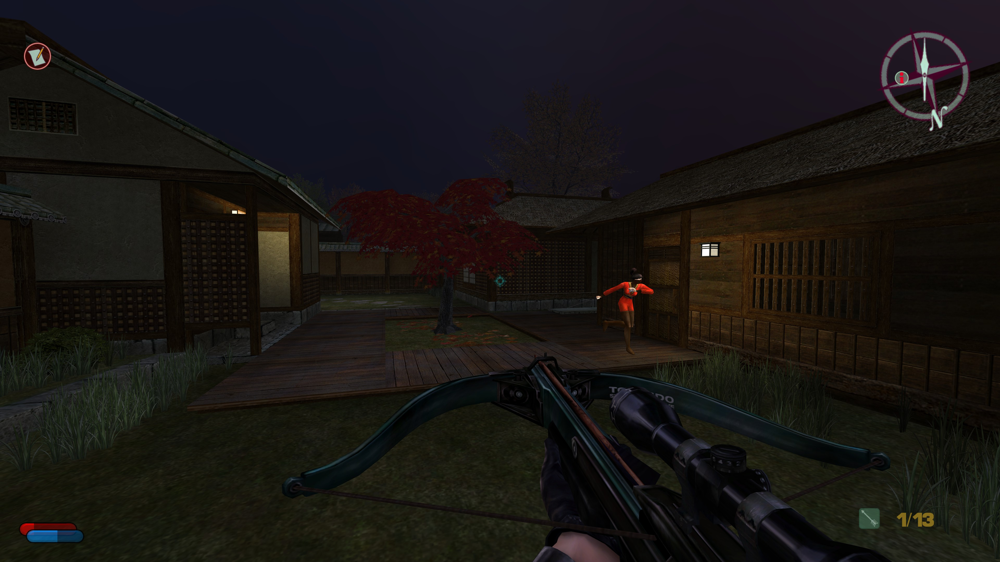
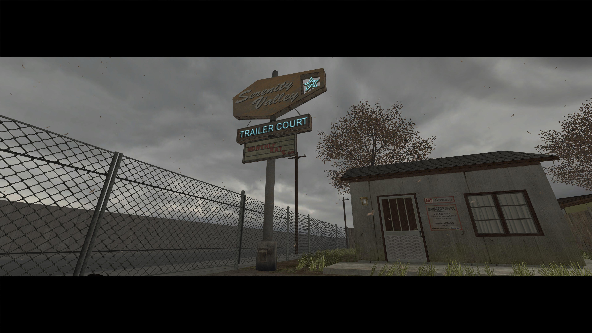
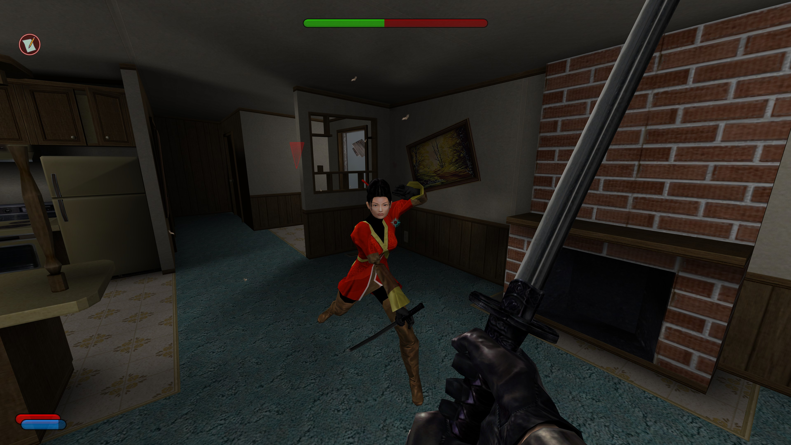
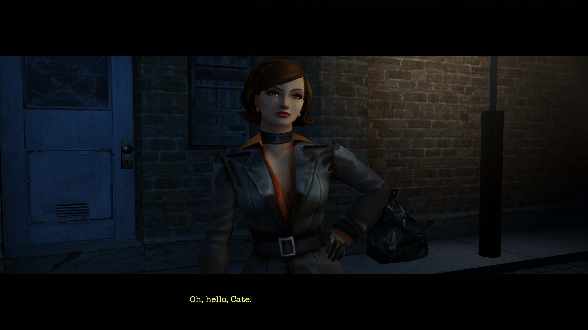
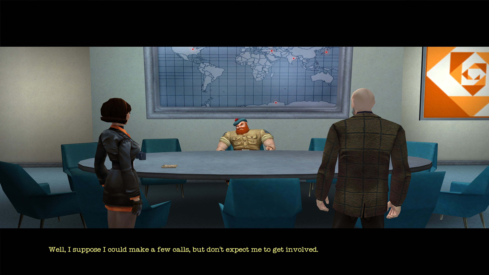
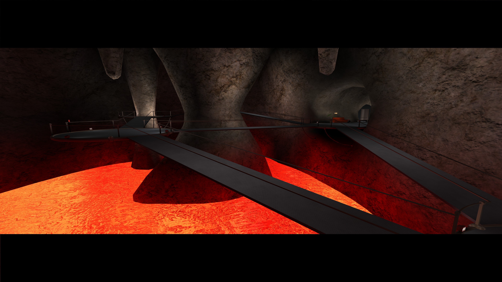
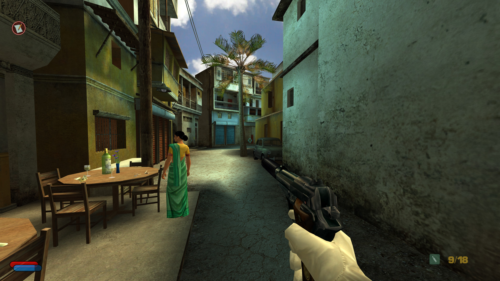

# nolf2src

*No One Lives Forever 2: A Spy in H.A.R.M.'s Way*, built from source.

The game code is Monolith's own public source release (version 1.3, the
game's last update), compiled with the compiler Monolith used, Visual C++ 6,
under Wine. Where the release differs from what the retail 1.3 game shipped,
the retail code is reconstructed from the retail binaries, in place, and
marked `RETAIL:`. The engine, which the release leaves out, is rebuilt from
the LithTech Jupiter engine source, taken back to the 2002 engine NOLF2
shipped with ([`docs/engine/PLAN.md`](docs/engine/PLAN.md)). The aim, as
for [nolfsrc](https://github.com/nolffan/nolfsrc) (the first game), is two
builds:

- **legacy**: the 1.3 game as it shipped, rebuilt so that it compiles back
  to the retail binaries byte for byte, as far as that can be done;
- **modern**: the same source with fixes and new features (`NOLF2SRC_MODERN`;
  [`docs/MODERN.md`](docs/MODERN.md)), and no RAD binary: its Bink player is
  ours, on FFmpeg.

Compiling back to the retail bytes means compiling the retail game's bugs as
well. The ones found so far are listed in [`docs/RETAIL_BUGS.md`](docs/RETAIL_BUGS.md);
their fixes go behind `NOLF2SRC_MODERN`, into the modern build only, so the
legacy build keeps matching the retail one.

<p align="center">
  
  
</p>
<p align="center">
  
  
</p>
<p align="center">
  
  
</p>
<p align="center">
  
  
</p>

## Documentation

To play: [`docs/INSTALL.md`](docs/INSTALL.md). Everything else -- the
modern build, the retail bugs, the build, the engine's reconstruction --
is listed in [`docs/README.md`](docs/README.md).

## Progress

How much of each binary compiles to exactly the bytes of the retail game,
function by function: the table, and how the scoring works and what it
leaves out, are in [`progress/README.md`](progress/README.md). Which
compiler built each binary, and the evidence, is `progress/COMPILERS.md`.

## Building

Needs docker and four submodules (`git submodule update --init`):
`ext/tools/` (the build's scripts, tests and byte-matching tools, shared with
the NOLF and Contract J.A.C.K. reconstructions), `ext/toolchains/` (the
compilers), `ext/lithtools/` (whose `lithrez` packs the 1.3 update's data,
`assets/`, into `nolf2src.rez`, and the map packs into `MapPack001.rez` and
`MapPack002.rez`) and `ext/rez/` (which fetches the European
discs from archive.org and installs the game with its 1.3 update, and the
USA discs, for the public archive's install scripts).

```sh
make            # out/nolf2-legacy-release/ and its -private / -public .tar.gz
make debug      # out/nolf2-legacy-debug/: symbols, NOLF2SRC_DEBUG
make modern     # out/nolf2-modern-release/: NOLF2SRC_MODERN (docs/MODERN.md)
make test       # play it under Xvfb: main menu, new game, the first level
make test TEST_GAME=out/nolf2-modern-release   # the same, on a variant
make help       # everything else
```

`make modern` also needs the `ext/ffmpeg` submodule (FFmpeg, pinned to a
release; `git submodule update --init ext/ffmpeg`): `build/ext.sh` builds
the modern build's `binkw32.dll` on it, with Zig (in the build image).
Each game directory has `linux-run.sh`, which starts the game with the
host's Wine through `NOLF2.exe`. Modern builds start immediately with the
launcher's saved settings and wait until `Lithtech.exe` exits; open
`NOLF2Launcher.exe` for the interactive launcher. Legacy builds open the
launcher: click Play. To go straight into a level when testing a build, use
`ext/tools/playtest.sh` (`make test` and `make shell`; its header has the
options). `linux-server.sh` runs the dedicated server `NOLF2Srv.exe`
(under `xvfb-run` without a display; `docs/INSTALL.md`, "A dedicated
server").

`build/build.mk` builds Monolith's workspace as Developer Studio would:
`ext/tools/dsp2mk.py` reads `TO2.dsw` and the project files and writes the
rules, compile for compile. [`docs/BUILDING.md`](docs/BUILDING.md)
describes the build step by step.

## Credits

This project builds on the work of others:

- **Monolith Productions**, for *No One Lives Forever 2* and for releasing
  its source code (version 1.3), which `src/Game/`, `src/Engine/sdk/` and
  `src/libs/` are; and, with LithTech, Inc. (later Touchdown
  Entertainment), for the LithTech Jupiter engine: `src/Engine/runtime/` is
  its source, back-ported to 2002
  ([`docs/LICENSE_NOTES.md`](docs/LICENSE_NOTES.md)).
- [StenApp](https://github.com/StenApp) for generously sharing his invaluable,
  in-depth knowledge of all things NOLF and LithTech.
- **NOLF 2 Modernizer** by HeyThereCoffeee (haekb):
  <https://github.com/haekb/nolf2-modernizer>. Many of the modern build's
  fixes and features were found and designed there;
  [`docs/MODERN.md`](docs/MODERN.md) names the Modernizer change behind
  each one. The modern build reimplements them rather than copying its code
  (`docs/MODERN.md`, "Rules for this work").
- **[nolfsrc](https://github.com/nolffan/nolfsrc)**, the same project for
  the first game: the method, the tools and guides, the Bink player, and
  many of the modern build's designs (each item that follows one says so).
- **FFmpeg** (<https://ffmpeg.org>), on which the modern build's Bink player
  is built.
- **Wine** and **Proton**, which run the game on Linux and the Steam Deck.
- **redump.org**, for the verified disc images the installers check
  against, and **archive.org**, which keeps them and the LithTech Jupiter
  SDK.
