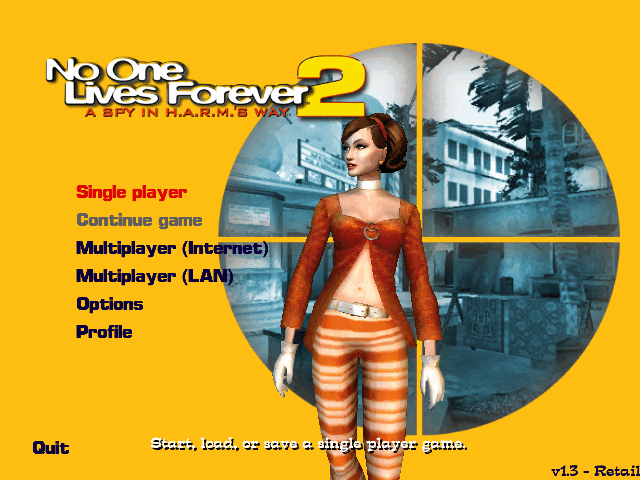
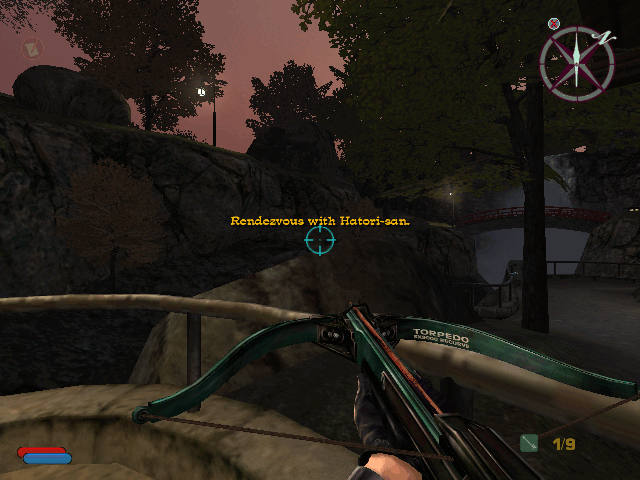

# nolf2src

*No One Lives Forever 2: A Spy in H.A.R.M.'s Way*, built from source.

The game code is Monolith's own public source release (version 1.3, the
game's last update), compiled with the compiler Monolith used, Visual C++ 6,
under Wine. Where the release differs from what the retail 1.3 game shipped,
the retail code is reconstructed from the retail binaries, in place, and
marked `RETAIL:`. The aim, as for [nolfsrc](https://github.com/nolffan/nolfsrc)
(the first game), is two builds:

- **legacy**: the 1.3 game as it shipped, rebuilt so that it compiles back
  to the retail binaries byte for byte, as far as that can be done;
- **modern**: the same source with fixes and new features (`NOLF2SRC_MODERN`;
  [`docs/MODERN.md`](docs/MODERN.md)), and no RAD binary: its Bink player is
  ours, on FFmpeg.

Compiling back to the retail bytes means compiling the retail game's bugs as
well. The ones found so far are listed in [`docs/RETAIL_BUGS.md`](docs/RETAIL_BUGS.md);
their fixes go behind `NOLF2SRC_MODERN`, into the modern build only, so the
legacy build keeps matching the retail one.

<p align="center">
  
  
</p>

## Documentation

| | |
|---|---|
| [`docs/INSTALL.md`](docs/INSTALL.md) | for players: from a release's public archive and your own discs to a running game, on Linux, the Steam Deck and Windows |
| [`CHANGELOG.md`](CHANGELOG.md) | what the modern build changes from the retail game |
| [`docs/CONSOLE.md`](docs/CONSOLE.md), [`docs/VARIABLES.md`](docs/VARIABLES.md) | the console commands and cheat codes; the console variables |
| [`docs/MODERN.md`](docs/MODERN.md) | the modern build, item by item, with the NOLF 2 Modernizer's every change |
| [`docs/RETAIL_BUGS.md`](docs/RETAIL_BUGS.md) | the retail game's bugs found while rebuilding it |
| [`docs/BUILDING.md`](docs/BUILDING.md), [`docs/SETUP-NOTES.md`](docs/SETUP-NOTES.md) | the build, step by step; how the base was set up |
| [`docs/LICENSE-NOTES.md`](docs/LICENSE-NOTES.md) | what is whose, and what each archive holds |
| [`docs/engine/`](docs/engine/) | the engine's reconstruction: the plan and its packages, the retail engine's anatomy |
| [`guides/`](guides/) | how to reconstruct a function so it compiles to the retail bytes |

## Where it stands

| | |
|---|---|
| Game DLLs | `CShell.dll`, `Object.lto`, `ClientFx.fxd`, `CRes.dll`, `SRes.dll` compile from Monolith's workspace (`src/Game/TO2.dsw`, Final configuration) and run in the game. Each is the retail binary's exact size, compiled with VC6 SP5 (build 8966) as retail was. `ClientFx.fxd`, `CRes.dll` and `SRes.dll` are byte for byte the retail ones apart from link time stamps; `CShell.dll` and `Object.lto` are close but not yet identical. |
| Dedicated server | `NOLF2Srv.exe` compiles; its code is the retail one's but for two `CButeMgr` functions (`libs/ButeMgr`), where SP5 orders two loads the other way round. |
| Launcher | `NOLF2.exe` compiles against the DirectX 8.1 SDK; every code segment matches the retail one's. It is in the game directory, and starts the game under Wine (`linux-run.sh`; in the legacy build it also writes the registry values the retail installer wrote). |
| Engine | Built here and in the game: `Lithtech.exe` and `server.dll` from the LithTech Jupiter engine source (a 2006 distribution of NOLF2's engine line, back-ported to 2002: `docs/engine/PLAN.md`), with no SecuROM; `snddrv.dll` and `ltmsg.dll` (byte for byte retail's but for its time stamp) reconstructed from the retail binaries; `ServerDir.dll` from Monolith's 1.3 `CServerDir_Titan` (as the F.E.A.R. source release carries it) and the LithTech Jupiter SDK's WONAPI (rez/ fetches the SDK, nothing of it is committed). Under Wine the game runs: the menus, a new game, the first level played with sound, saving and loading (`make test`). Nothing of the retail engine is in the game directory: every binary there is built here but the third-party runtime (Bink, the Microsoft C++ and MFC DLLs; the modern build plays the movies with its own Bink player on FFmpeg). |
| Scoring | `make progress` scores every binary function by function against the retail 1.3 ones (below, and `progress/README.md`). |

## Progress

How much of each binary compiles to exactly the bytes of the retail game
(version 1.3). A function counts when our compiled code is identical to the
retail function, with only the addresses the linker fills in left out of
the comparison; the bars measure the share of each binary's code, by size,
those functions make up. The engine is counted with the rest: the total
is the whole game.

<!-- progress:begin -->
<!-- generated by tools/ratchet.py from progress/summary.json: edit neither by hand; `make progress-update` rewrites both -->

| Binary | | Byte-identical functions | Byte-identical code | | Unwritten | Unplaced |
|---|---|--:|--:|---|--:|--:|
| `Lithtech.exe` | the engine | 6,298 / 6,848 | 1,290,626 / 1,345,390 bytes | `███████████████████░` 95.9% | 3 | 23 |
| `server.dll` | the engine's server | 2,862 / 3,475 | 303,173 / 310,901 bytes | `███████████████████░` 97.5% | 0 | 3 |
| `ServerDir.dll` | the server directory (WON Titan) | 457 / 492 | 88,815 / 89,212 bytes | `███████████████████░` 99.5% | 0 | 0 |
| `snddrv.dll` | the sound driver | 210 / 236 | 35,176 / 35,599 bytes | `███████████████████░` 98.8% | 0 | 0 |
| `NOLF2.exe` | the launcher | 339 / 409 | 49,293 / 49,896 bytes | `███████████████████░` 98.7% | 0 | 6 |
| `NOLF2Srv.exe` | the dedicated server | 543 / 595 | 86,191 / 87,238 bytes | `███████████████████░` 98.7% | 0 | 0 |
| `CShell.dll` | the game: client | 6,336 / 7,224 | 1,313,809 / 1,326,222 bytes | `███████████████████░` 99.0% | 0 | 1 |
| `Object.lto` | the game: server objects | 11,773 / 13,263 | 1,886,285 / 1,909,606 bytes | `███████████████████░` 98.7% | 0 | 3 |
| `ClientFx.fxd` | the game: client effects | 409 / 499 | 119,817 / 120,975 bytes | `███████████████████░` 99.0% | 0 | 0 |
| `ltmsg.dll` | the engine's messages, not in the total | 5 / 5 resources | 2,054 / 2,054 bytes | `████████████████████` 100.0% | 0 | -- |
| `CRes.dll` | the game's client resources, not in the total | 484 / 484 resources | 622,940 / 622,940 bytes | `████████████████████` 100.0% | 0 | -- |
| `SRes.dll` | the game's server resources, not in the total | no resources | -- | -- | -- | -- |
| `Lithtech.exe:rsrc` | the engine's resources, not in the total | 27 / 27 resources | 18,762 / 18,762 bytes | `████████████████████` 100.0% | 0 | -- |
| `server.dll:rsrc` | the engine's server's resources, not in the total | 2 / 2 resources | 760 / 760 bytes | `████████████████████` 100.0% | 0 | -- |
| `NOLF2.exe:rsrc` | the launcher's resources, not in the total | 112 / 112 resources | 4,963,404 / 4,963,404 bytes | `████████████████████` 100.0% | 0 | -- |
| `NOLF2Srv.exe:rsrc` | the dedicated server's resources, not in the total | 17 / 17 resources | 936,722 / 936,722 bytes | `████████████████████` 100.0% | 0 | -- |
| **All** | | **29,227 / 33,041** | **5,173,185 / 5,275,039 bytes** | `███████████████████░` **98.0%** | **3** | **36** |
<!-- progress:end -->

Every function in that table is recorded in `progress/identical.txt`, and
`make progress` re-scores the current build against the retail binaries and
fails if any of them stops matching. See `progress/README.md` for how the
scoring works and what it leaves out: the C runtime and import thunks, the
statically linked D3DX in `Lithtech.exe`, the WON/Titan library (WONAPI,
with GameSpy's query reporting) in `ServerDir.dll`, and the pages of
`Lithtech.exe` that SecuROM keeps encrypted. Which compiler built each
binary, and the evidence, is `progress/COMPILERS.md`.

## Building

Needs docker and three submodules (`git submodule update --init`):
`tools/` (the build's scripts, tests and byte-matching tools, shared with
the NOLF and Contract J.A.C.K. reconstructions), `toolchains/` (the
compilers) and `rez/` (which fetches the European discs from archive.org
and installs the game with its 1.3 update, and the USA discs, for the
public archive's install scripts).

```sh
make            # out/nolf2-legacy-release/ and its -private / -public .tar.gz
make debug      # out/nolf2-legacy-debug/: symbols, NOLF2SRC_DEBUG
make modern     # out/nolf2-modern-release/: NOLF2SRC_MODERN (docs/MODERN.md)
make test       # play it under Xvfb: main menu, new game, the first level
make test TEST_GAME=out/nolf2-modern-release   # the same, on a variant
make help       # everything else
```

`make modern` also needs the `ext/ffmpeg` submodule (FFmpeg, pinned to a
release; `git submodule update --init ext/ffmpeg`): `build/ext.sh` builds
the modern build's `binkw32.dll` on it, with Zig (in the build image).
Each game directory has `linux-run.sh`, which starts the game with the
host's Wine through `NOLF2.exe`. Modern builds start immediately with the
launcher's saved settings and wait until `Lithtech.exe` exits; open
`NOLF2Launcher.exe` for the interactive launcher. Legacy builds open the
launcher: click Play. To go straight into a level when testing a build, use
`tools/playtest.sh` (`make test` and `make shell`; its header has the
options). `linux-server.sh` runs the dedicated server `NOLF2Srv.exe`
(under `xvfb-run` without a display; `docs/INSTALL.md`, "A dedicated
server").

`build/build.mk` builds Monolith's workspace as Developer Studio would:
`tools/dsp2mk.py` reads `TO2.dsw` and the project files and writes the
rules, compile for compile. [`docs/BUILDING.md`](docs/BUILDING.md)
describes the build step by step.

## Playing it elsewhere: the archives

To play elsewhere, copy `out/nolf2-legacy-release-private.tar.gz` (one
file), unpack it and run `nolf2-legacy-release/linux-run.sh`. Every variant is
packaged the same way: `out/nolf2-legacy-debug-private.tar.gz`,
`out/nolf2-modern-release-private.tar.gz` and
`out/nolf2-modern-debug-private.tar.gz`.

The `-private` archives hold the retail game's data (1.8 GB of it), so they
are for your own machines and for others developing on the build. To give
the game to anyone else, give them the `-public` archive instead
(`out/nolf2-modern-release-public.tar.gz`, a few MB): the same directory
without anything from the retail game, and two scripts that install it
from their own disc images of *No One Lives Forever 2* (the European or
the USA release) and Sierra's English 1.3 update, `nolf2-update_1x3.exe`
-- without installing the game. An image can be a plain `.iso` (an own
rip), redump's `.bin` (or its `.cue`), or redump's `.zip` as archive.org
serves it; a `.bin` or `.zip` is converted to a temporary `.iso` first
(about 0.6 GB a disc). On Linux they need `python3`, whose zlib unpacks
the setup's compressed cabinets; on Windows, the PowerShell every Windows
10 and 11 has. They check each image's SHA-256 and every file they write,
so the result is the `-private` archive's directory, byte for byte:

```sh
nolf2-modern-release/linux-install.sh disc1.zip disc2.zip nolf2-update_1x3.exe   # Linux, Steam Deck
```

On Windows, drop both images and the update onto `windows-install.bat` (or
put them in the game folder and double-click it), then start `NOLF2.exe`.
Either script finds them in the game directory or the one above it by
itself, and can be run again: a file already in place is checked and kept.
The archive is the whole game, not a patch: its last file, `SHA256SUMS`,
lists every file of it and every file the scripts write, and they check
the directory against it first, refusing one that holds anything else (a
release unpacked over another installation). After an install,
`sha256sum -c SHA256SUMS` checks every file.
The public archive is made only if `rez/isos/` has the `.iso` images of
both releases' discs (`make retail` fetches them; `tools/mkinstall.py`).
The GitHub Actions workflow builds the four public archives on every push,
and for a tag `v*` makes a GitHub release with the modern build's two
attached as `nolf2src-<tag>.tar.gz` and `nolf2src-debug-<tag>.tar.gz`
(`docs/BUILDING.md`). For players, [`docs/INSTALL.md`](docs/INSTALL.md)
walks through it.

The modern build plays with a controller: an Xbox-style (XInput) pad, which
is also what Steam Input makes of the Steam Deck's controls and of most other
pads. The sticks move and look, the triggers fire and zoom, A skips a
cut-scene, and the menus follow the d-pad, A and B; Options > Controls >
Controller sets the look speed and dead zones, and Configure controls binds
the buttons like keys (`docs/MODERN.md` M-G47). So far it is tested with a
simulated pad only.

See [`docs/LICENSE-NOTES.md`](docs/LICENSE-NOTES.md) for what is whose, and
what each archive holds.

## Credits

This project builds on the work of others:

- **Monolith Productions**, for *No One Lives Forever 2* and for releasing
  its source code (version 1.3), which `src/Game/`, `src/Engine/sdk/` and
  `src/libs/` are; and, with LithTech, Inc. (later Touchdown
  Entertainment), for the LithTech Jupiter engine: `src/Engine/runtime/` is
  its source, back-ported to 2002
  ([`docs/LICENSE-NOTES.md`](docs/LICENSE-NOTES.md)).
- [StenApp](https://github.com/StenApp) for generously sharing his invaluable,
  in-depth knowledge of all things NOLF and LithTech.
- **NOLF 2 Modernizer** by HeyThereCoffeee (haekb):
  <https://github.com/haekb/nolf2-modernizer>. Many of the modern build's
  fixes and features were found and designed there;
  [`docs/MODERN.md`](docs/MODERN.md) names the Modernizer change behind
  each one. The modern build reimplements them rather than copying its code
  (`docs/MODERN.md`, "Rules for this work").
- **[nolfsrc](https://github.com/nolffan/nolfsrc)**, the same project for
  the first game: the method, the tools and guides, the Bink player, and
  many of the modern build's designs (each item that follows one says so).
- **FFmpeg** (<https://ffmpeg.org>), on which the modern build's Bink player
  is built.
- **Wine** and **Proton**, which run the game on Linux and the Steam Deck.
- **redump.org**, for the verified disc images the installers check
  against, and **archive.org**, which keeps them and the LithTech Jupiter
  SDK.
